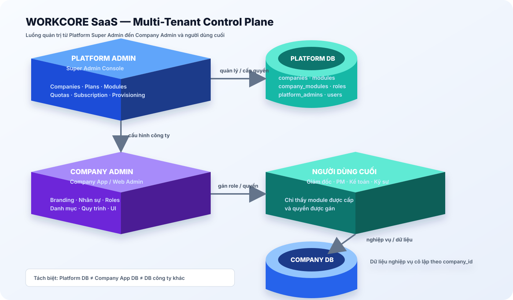

<div align="center">

# 🌐 WORKCORE SaaS Platform
### Trung Tâm Điều Hành & Quản Trị Đa Doanh Nghiệp (Multi-Tenant Central Console)

[](LICENSE)
[](https://reactjs.org/)
[](https://www.typescriptlang.org/)
[](https://vitejs.dev/)
[](https://tailwindcss.com/)
[](https://supabase.com/)

<p align="center">
  <b>Bảng điều khiển chuyên trách dành cho Platform Super Admin để quản lý danh sách công ty khách hàng, phân bổ gói thuê bao, cấp phát tài nguyên và kiểm soát bản quyền modules trong hệ sinh thái WORKCORE.</b>
</p>

---

</div>

## 📌 1. Giới thiệu tổng quan (Overview)

**WORKCORE SaaS Platform** là ứng dụng độc lập đóng vai trò là "Tổng hành dinh" (Control Plane) của toàn bộ hệ sinh thái phần mềm quản lý công việc và dự án WORKCORE. 

Trước đây, khi phần mềm được viết dưới dạng đơn doanh nghiệp (Single Tenant), các thông tin thương hiệu, cấu hình quản trị công ty bị gộp chung vào ứng dụng nghiệp vụ. **WORKCORE SaaS Platform ra đời để tách biệt hoàn toàn**:
- **Ứng dụng SaaS Platform (Repo này):** Dành riêng cho đội ngũ phát triển và Quản trị viên hệ thống cấp cao nhất (**Platform Super Admin**) để kinh doanh phần mềm, quản lý hợp đồng thuê bao, mở/khóa các công ty khách hàng.
- **Ứng dụng Nghiệp vụ (Client Web/App):** Dành cho từng công ty khách hàng cụ thể (Ví dụ: *TITSMART, Xây dựng Hòa Bình, An Phong,...*), dữ liệu được cô lập 100% theo `company_id`.

---

## 🏗️ 2. Kiến trúc hệ thống (Architecture)



> Platform DB chỉ quản lý tenant, gói dịch vụ, module và quyền cấp phát. Company App DB lưu dữ liệu nghiệp vụ riêng của từng công ty; không dùng chung hoặc reset DB product.

```text
┌────────────────────────────────────────────────────────────────────────┐
│                        WORKCORE SaaS Platform                          │
│               https://github.com/neitpm/workcore-saas-platform         │
│  - Super Admin Dashboard                                               │
│  - Quản lý Tenants (Công ty khách hàng)                                │
│  - Cấu hình gói thuê bao (Trial / Standard / Pro / Enterprise)         │
│  - Bật / Tắt 13 Module nghiệp vụ độc lập cho từng công ty              │
│  - Tự động sinh tài khoản Company Admin khi tạo tenant mới             │
└───────────────────────────────────┬────────────────────────────────────┘
                                    │ (Platform DB riêng)
                                    ▼
┌────────────────────────────────────────────────────────────────────────┐
│                      WORKCORE Platform Database                        │
│                                                                        │
│  [companies] ───< [company_modules] >─── [modules]                     │
│       │                                                                │
│       ├─── [company_users] (Tài khoản Company Admin / user)            │
│       ├─── [company_roles] (Role và quyền cấp phát)                   │
│       └─── [company_databases] (Thông tin DB/tenant, không chứa        │
│                                 dữ liệu nghiệp vụ product)             │
└───────────────────────────────────┬────────────────────────────────────┘
                                    │
                                    ▼
┌────────────────────────────────────────────────────────────────────────┐
│                   WORKCORE Business Client Apps                        │
│            (Web Admin, Mobile App Android & iOS, Desktop)              │
│  - Company Admin: Quản lý phòng ban, dự án, phân quyền nhân sự nội bộ  │
│  - Giám đốc, Kế toán, PM, Kỹ sư hiện trường thao tác nghiệp vụ         │
│  - Đọc cấu hình và module qua API/adapter của Company App               │
└────────────────────────────────────────────────────────────────────────┘

> Dữ liệu nghiệp vụ như `projects`, `tasks`, `expenses`, `materials` thuộc Company App DB riêng. Platform không ghi trực tiếp vào DB product.
```

---

## ✨ 3. Tính năng cốt lõi (Core Features)

## 🧭 Chạy các service local

Vị trí source: Platform Super Admin ở `D:\workcore-saas-platform-platform-admin\src`, Platform API ở `local-api`, Platform DB/migration ở `supabase-platform`. Company Admin/User clone ở `D:\Titsmart_task-platform-admin\web-admin`; bản Company App cũ ở `D:\HỆ THỐNG QUẢN LÝ CÔNG VIỆC-web-app-titsmart\web-admin`.

Chuẩn bị Platform: `cd D:\workcore-saas-platform-platform-admin; npm install`. Chuẩn bị Company App: `cd D:\Titsmart_task-platform-admin\web-admin; npm install`. Hai phần phải dùng `.env.local` riêng và không được dùng `PRODUCT_SUPABASE_*`.

Khởi động Platform DB bằng Supabase: `cd /mnt/d/workcore-saas-platform-platform-admin && supabase start && supabase status && supabase db push --workdir /mnt/d/workcore-saas-platform-platform-admin/supabase-platform`. Hoặc Docker: `cd D:\workcore-saas-platform-platform-admin; docker compose -f docker-compose.platform-db.yml up -d`.

Khởi động Platform API ở terminal riêng: `cd D:\workcore-saas-platform-platform-admin; npm run dev:provision`.

Khởi động Platform Super Admin ở terminal riêng: `cd D:\workcore-saas-platform-platform-admin; npm run dev -- --host 0.0.0.0 --port 3001`; mở `http://localhost:3001`.

Khởi động Company Admin/User ở terminal riêng: `cd D:\Titsmart_task-platform-admin\web-admin; npm run dev:local`; mở URL Vite in ra, thường là `http://localhost:5173`. Company Admin và User dùng cùng Company App, quyền điều hướng theo tài khoản.

Thứ tự chạy: Platform DB → Platform API → Platform Super Admin UI → Company App/User UI. Kiểm tra Network để bảo đảm Company App gọi Platform API, không truy cập trực tiếp Product DB.

Dừng Platform Docker: `cd D:\workcore-saas-platform-platform-admin; docker compose -f docker-compose.platform-db.yml down`. Không chạy `supabase stop/start`, migration hoặc Docker down trong thư mục Product.

Trước commit: kiểm tra branch riêng, `.env.local`, port, database URL; build Platform và Company App riêng; không commit secret.

### 🏢 3.1. Quản lý Đa Doanh Nghiệp (Tenant Management)
- **Đăng ký công ty mới:** Thiết lập Tên doanh nghiệp, Mã công ty (`code` - Unique), Mã số thuế, Slogan, Logo.
- **Tự động cấp quyền Company Admin:** Ngay khi tạo công ty, hệ thống tự động sinh tài khoản Quản trị viên / Giám đốc cho công ty đó với quyền `company_admin`, cho phép bàn giao ngay cho khách hàng.
- **Quản lý trạng thái vận hành:** Chuyển trạng thái linh hoạt giữa `active` (Đang hoạt động), `suspended` (Tạm khóa khi quá hạn thanh toán) và `expired` (Hết hạn hợp đồng).

### 💳 3.2. Quản lý Gói Thuê Bao & Hạn Mức (Subscriptions & Quotas)
- **4 Cấp độ gói dịch vụ:**
  - 🟢 **Trial (Dùng thử):** 14 ngày trải nghiệm, tối đa 5 tài khoản, 2 GB lưu trữ.
  - 🔵 **Standard (Tiêu chuẩn):** Doanh nghiệp vừa & nhỏ, 25 tài khoản, 20 GB lưu trữ.
  - 🟣 **Professional (Chuyên nghiệp):** Đa dự án, quy trình tài chính sâu, 60 tài khoản, 50 GB lưu trữ.
  - 👑 **Enterprise (Doanh nghiệp lớn):** Không giới hạn tài khoản, 200 GB+ lưu trữ, White-label thương hiệu riêng, hỗ trợ SLA 24/7.
- **Giới hạn tài nguyên:** Kiểm soát chính xác `max_users` và `max_storage_gb` cho từng tenant.
- **Thời hạn bản quyền:** Quản lý ngày kích hoạt và ngày hết hạn thuê bao; cảnh báo tự động khi sắp đến kỳ gia hạn.

### 🧩 3.3. Bật / Tắt Module Nghiệp Vụ Linh Hoạt (Feature Toggling)
Hệ thống chuẩn hóa 13 module cốt lõi. Super Admin có thể bật hoặc tắt từng module cụ thể cho mỗi công ty chỉ bằng 1 nút gạt:
1. `PROJECTS`: Quản lý danh mục dự án & tiến độ tổng thể.
2. `TASKS`: Phân công công việc, WBS, tiến độ thi công.
3. `MATERIALS`: Quản lý kế hoạch vật tư & nhu cầu thi công.
4. `PURCHASING`: Mua sắm, theo dõi đặt hàng và giao hàng.
5. `EXPENSES`: Quản lý phiếu chi, tạm ứng & tài chính dự án.
6. `FUND_REQUEST`: Quy trình phê duyệt & cấp quỹ đa cấp.
7. `LABOR_PAYROLL`: Nhân công thuê ngoài & bảng thanh toán công.
8. `FIELD_LOGS`: Nhật ký giám sát & thi công hiện trường.
9. `DOCUMENTS`: Quản lý hợp đồng & theo dõi luân chuyển hồ sơ.
10. `INVENTORY`: Quản lý kho, xuất - nhập - tồn vật tư.
11. `ATTENDANCE`: Chấm công, đơn từ nghỉ phép & nhân sự.
12. `REPORTS`: Báo cáo quản trị, phân tích dòng tiền & hiệu suất.
13. `SETTINGS`: Cấu hình danh mục & phân quyền nội bộ công ty.

### 📊 3.4. Bảng Giám Sát Tài Nguyên Trung Tâm (Central Monitoring)
- Thống kê thời gian thực: Tổng số công ty đang hoạt động, tổng số nhân sự được cấp phép toàn hệ thống, tổng dung lượng lưu trữ phân bổ.
- Danh sách khách hàng mới kích hoạt, hỗ trợ tìm kiếm và lọc tức thì theo mã công ty, gói cước hoặc trạng thái.

---

## 📂 4. Cấu trúc thư mục (Project Structure)

```text
workcore-saas-platform/
├── .env                          # Biến môi trường kết nối Supabase
├── .gitignore                    # Các tệp loại trừ khỏi Git
├── index.html                    # Điểm vào HTML chính
├── package.json                  # Định nghĩa dependencies & scripts
├── postcss.config.js             # Cấu hình PostCSS cho Tailwind
├── tailwind.config.js            # Cấu hình giao diện Dark Modern
├── tsconfig.json                 # Cấu hình TypeScript
├── vite.config.ts                # Cấu hình Vite Dev Server
├── src/
│   ├── App.tsx                   # Bố cục giao diện chính & điều hướng tabs
│   ├── index.css                 # CSS toàn cục & custom scrollbar
│   ├── main.tsx                  # Điểm khởi chạy React DOM
│   ├── vite-env.d.ts             # Khai báo kiểu môi trường Vite
│   ├── components/
│   │   ├── Sidebar.tsx           # Thanh điều hướng menu bên trái
│   │   ├── DashboardOverview.tsx # Màn hình tổng quan & thống kê SaaS
│   │   ├── TenantsManagement.tsx # Màn hình CRUD công ty, cấp quyền & toggle module
│   │   └── ModulesOverview.tsx   # Danh mục 13 module & bảng giá 4 gói cước
│   ├── lib/
│   │   └── supabase.ts           # Khởi tạo kết nối Supabase Client
│   ├── store/
│   │   └── platformStore.ts      # Quản lý state toàn cục (Zustand + Supabase REST)
│   └── types/
│       └── index.ts              # Định nghĩa kiểu dữ liệu (Tenants, Modules, Plans)
└── README.md                     # Tài liệu hướng dẫn sử dụng chi tiết
```

---

## 🚀 5. Hướng dẫn cài đặt & Khởi chạy (Getting Started)

### 5.1. Yêu cầu môi trường
- **Node.js**: Phiên bản `18.x` hoặc `20.x` trở lên.
- **npm** (hoặc `pnpm`, `yarn`).
- **Trình duyệt hiện đại**: Chrome, Edge, Safari, Firefox.

### 5.2. Cài đặt các gói phụ thuộc
Clone repository về máy và cài đặt dependencies:
```bash
git clone https://github.com/neitpm/workcore-saas-platform.git
cd workcore-saas-platform
npm install
```

### 5.3. Cấu hình biến môi trường
Không commit URL/key thật vào README. Khi chạy local, file `.env` của Platform trỏ tới Supabase Platform local:
```env
VITE_SUPABASE_URL=http://127.0.0.1:55321
VITE_SUPABASE_ANON_KEY=[publishable key của Platform local]
```

Platform local là DB riêng, không dùng chung DB của Company App.

### 5.4. Khởi động Supabase Platform local
```bash
cd /mnt/d/workcore-saas-platform
supabase start --workdir /mnt/d/workcore-saas-platform/supabase-platform
```

Các địa chỉ local:

- API: `http://127.0.0.1:55321`
- Database: `127.0.0.1:55322`
- Studio: `http://127.0.0.1:55323`
- Mailpit: `http://127.0.0.1:55324`

### 5.5. Chạy Platform Admin
```bash
npm run dev
```
Mở trình duyệt truy cập: **`http://localhost:3001`**

### 5.6. Chạy Provisioning API local
Mở terminal thứ hai:
```bash
cd /mnt/d/workcore-saas-platform
cp .env.local.example .env.local
# Mở .env.local và điền secret local một lần
npm run dev:provision
```

API provision chạy tại `http://127.0.0.1:55400`.
Không ghi secret thật vào README hoặc commit lên GitHub.

### 5.7. Đăng nhập Company Admin

Trang đăng nhập Company Admin của Company App:

```text
http://localhost:5173/#/company-admin/login
```

Company Admin dùng Supabase Auth của Platform local:

```text
POST http://127.0.0.1:55321/auth/v1/token?grant_type=password
```

Body:

```json
{
  "email": "admin@tencongty.vn",
  "password": "mat-khau"
}
```

Frontend gọi endpoint này thông qua `platformAuthClient.auth.signInWithPassword()`.

### 5.8. Đóng gói triển khai (Production Build)
```bash
npm run build
```
Bản build tối ưu hóa sẽ được tạo tại thư mục `dist/` sẵn sàng triển khai lên Vercel, Netlify, Cloudflare Pages hoặc Docker Nginx.

---

## 🔒 6. Bảo mật & Cô lập dữ liệu (Security & Isolation)

1. **Kiểm soát truy cập (Access Control):** Chỉ những tài khoản có vai trò `super_admin` trên bảng quản trị mới có quyền truy cập ứng dụng này. Người dùng nghiệp vụ của các công ty khách hàng hoàn toàn không có quyền thao tác trên các bảng `companies` và `company_modules`.
2. **Cô lập theo Row Level Security (RLS):** Mọi truy vấn từ các ứng dụng nghiệp vụ bên ngoài bắt buộc phải đi kèm điều kiện `company_id = auth.user.company_id`. Dữ liệu của công ty này sẽ hoàn toàn vô hình đối với công ty khác.
3. **Quản lý mật khẩu:** Mật khẩu Company Admin khởi tạo ban đầu được mã hóa và bảo mật, buộc người dùng đổi mật khẩu trong lần đăng nhập đầu tiên.

---

## 👥 7. Đóng góp & Bản quyền (License & Authors)

- **Phát triển bởi:** Đội ngũ Kỹ sư Công nghệ WORKCORE / TITSMART
- **Bản quyền:** © 2026 WORKCORE Platform. Mọi quyền được bảo lưu.
- **Mã nguồn:** Lưu trữ nội bộ phục vụ quản trị nền tảng SaaS.
